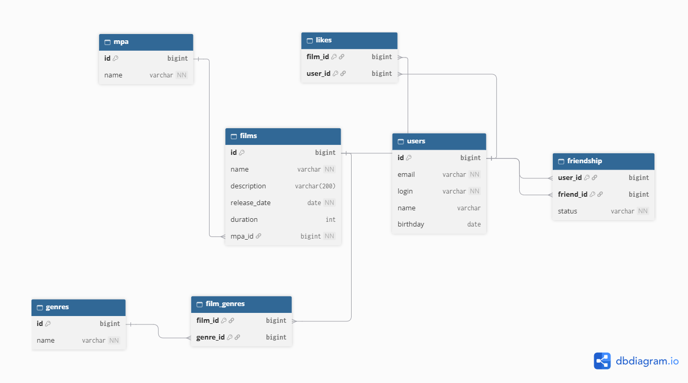

## Схема базы данных

Исходник схемы: [docs/schema.dbml](docs/schema.dbml)

### Таблицы

- `films` — фильмы
- `users` — пользователи
- `mpa` — справочник рейтингов MPA (G, PG, PG-13, R, NC-17)
- `genres` — справочник жанров
- `likes`, `film_genres`, `friendship` — таблицы связей

### Связи

**Фильм → рейтинг MPA (многие к одному).**
У каждого фильма ровно один рейтинг, один рейтинг может быть у многих фильмов.
Связь хранится в колонке `films.mpa_id`, которая ссылается на `mpa.id`.

**Фильм ↔ жанр (многие ко многим).**
У фильма может быть несколько жанров, один жанр может быть у многих фильмов.
Связь хранится в таблице `film_genres`: одна строка — один жанр одного фильма.

**Пользователь ↔ фильм, лайки (многие ко многим).**
Пользователь может лайкнуть много фильмов, у фильма может быть много лайков от разных пользователей.
Связь хранится в таблице `likes`: одна строка — лайк одного пользователя одному фильму.
Составной первичный ключ `(film_id, user_id)` не даёт лайкнуть один фильм дважды.

**Пользователь ↔ пользователь, дружба (многие ко многим).**
Пользователь может дружить со многими пользователями, и у каждого из них, в свою очередь, много друзей.
Связь хранится в таблице `friendship`, обе колонки ссылаются на `users.id`.
Строка `(user_id, friend_id)` означает: у `user_id` в списке друзей есть `friend_id`.

Колонка `status` хранит состояние дружбы:
- `PENDING` — `user_id` отправил запрос, `friend_id` его ещё не принял;
- `CONFIRMED` — `friend_id` принял запрос, дружба подтверждена.

Отклонённый запрос удаляется из таблицы, отдельного статуса для него нет.